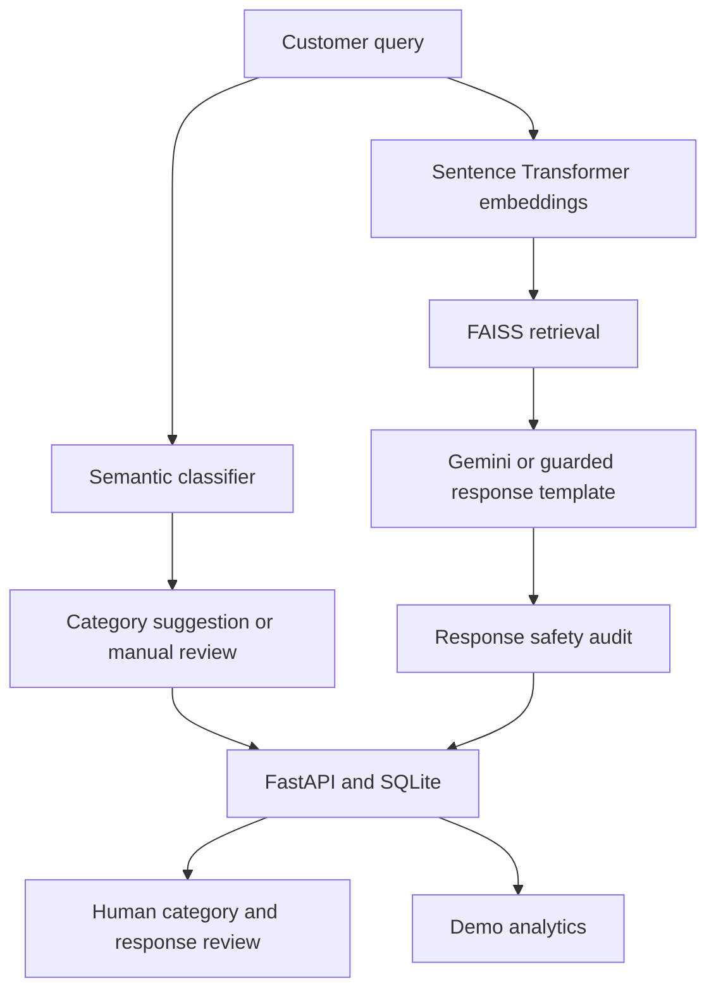

# SupportIQ — AI-Powered Customer Support & Intelligence Platform

An experimental end-to-end customer support intelligence platform combining operational data analysis, machine learning, retrieval-augmented generation (RAG), and human-in-the-loop ticket management.

## Project status

| Component | Status |
|---|---|
| Standalone FastAPI backend and Streamlit frontend | Implemented and locally tested in Colab |
| Private application bundle | Created; 65 files, 40.31 MB |
| Public source release | Pending |
| Power BI historical analytics | Planned |
| Clean installation, Windows and public deployment | Not verified |

## Business objectives

- Categorize incoming tickets and suggest routing with uncertainty-aware review.
- Retrieve relevant support examples and generate draft responses.
- Prevent unsupported claims of completed customer account actions.
- Preserve original predictions and human corrections for future evaluation.
- Track ticket review and safety metrics.

## Data sources

| Dataset | Purpose | Records |
|---|---|---:|
| [Support Ticket Dataset](https://huggingface.co/datasets/s2pidape/support-ticket-dataset), humans_only | Operational analysis and category classification | 1,500,000 |
| [Bitext Customer Support](https://huggingface.co/datasets/bitext/Bitext-customer-support-llm-chatbot-training-dataset) | Retrieval and response experiments | 26,872 |

[Bitext publisher repository](https://github.com/bitext/customer-support-llm-chatbot-training-dataset). These are separate datasets; Bitext examples are not verified company policies or ground-truth responses for the operational tickets. Raw data and derived artifacts are withheld pending redistribution-license review.

## Architecture

## Implementation

### Data audit and feature engineering
- 1.5 million records, 38 source columns, 11 categories and 100 issue types.
- 277,373 distinct descriptions; 1,222,627 repeated rows by description.
- Investigated unusually high ticket volumes on September 4–5, 2023; cause unverified.
- Excluded post-intake outcomes and direct customer identifiers from classification features.
- Grouped split by normalized description to prevent exact-text overlap. Near-duplicate leakage remains possible.

### Machine learning
Baseline: TF-IDF bigrams, metadata preprocessing and SGDClassifier with logistic loss. Primary model: all-MiniLM-L6-v2 embeddings (384 dimensions) and logistic regression trained on a balanced sample of 5,500 descriptions.

| Evaluation | Result |
|---|---:|
| Baseline grouped dataset test | 100% accuracy |
| Baseline text-only temporal test | 100% accuracy |
| Metadata-only ablation | 9.12% accuracy |
| Baseline on 12 manually authored development queries | 7/12 (58.33%) |
| Semantic model on same development queries | 12/12 |
| Semantic model on 33 additional authored queries | 32/33 (96.97%) |
| Semantic suggestions at experimental 0.70 threshold | 28/33 |
| Correct suggestions within that subset | 28/28 |

Perfect dataset scores likely reflect templated language, not production reliability. Authored queries are AI-assisted, not independently sourced customer tickets. The threshold was selected using the validation sample and is not calibrated. All predictions remain subject to human review.

### Retrieval and generation
- Sentence Transformers, normalized embeddings and FAISS IndexFlatIP over 26,872 examples.
- Experimental retrieval threshold 0.50.
- Gemini generation with configured model and deterministic responses for sensitive operational requests.
- Placeholder, unsupported-action, portal-assumption and personal-information-request checks.
- Ten scripted safety examples passed the implemented audit; this does not establish comprehensive safety.

### API and persistence

| Method | Route | Purpose |
|---|---|---|
| GET | / | Service metadata |
| GET | /health | Basic health response |
| POST | /classify | Semantic category suggestion |
| POST | /support | Guarded draft generation |
| POST | /tickets | Create pending ticket |
| GET | /tickets | List and filter tickets |
| GET | /tickets/{id} | Retrieve ticket |
| POST | /tickets/{id}/review | Approve, edit or reject draft |
| POST | /tickets/{id}/category-review | Confirm or correct category |
| GET | /analytics | Demo ticket metrics |

SQLite preserves original prediction, confidence, alternative categories, reviewed category and response approval status. Duplicate category reviews and invalid categories are blocked. Category correction does not automatically retrain the model. No real refunds, cancellations, transfers or message delivery occur.

## Validation checkpoint

| Standalone validation | Passed |
|---|---:|
| Local backend server | 5/5 |
| Live HTTP service | 8/8 |
| Frontend pages | 5/5 |
| End-to-end ticket creation | 11/11 |
| Human review workflow | 11/11 |
| Analytics checks | 14/14 |
| Required files | 21/21 |
| Credential pattern scan | 56/56 |
| Installed dependency versions | 18/18 |

The 36 end-to-end checks cover a controlled single-ticket workflow, not production performance.

- Human response review: five scripted validation checks passed.
- Approval/rejection: two decision checks passed.
- Category correction: three checks passed (invalid category, valid correction, duplicate review).
- Both exported classifiers reloaded successfully and reproduced tested predictions; semantic probabilities also matched.
- API tests use FastAPI TestClient in Colab, not a deployed server.

## Application walkthrough

| Page | Purpose |
|---|---|
| Overview Dashboard | Demo ticket KPIs, category distribution, approval and retrieval metrics |
| Create Support Ticket | Submit a query, inspect category suggestions and guarded draft |
| Ticket Management | Search, filter and inspect stored tickets |
| Human Review Centre | Approve, edit or reject drafts and correct categories |
| Model Performance | Compare classifiers and monitor human corrections |

All five pages passed the post-styling Streamlit AppTest rendering check with zero reported errors or exceptions. Local HTTP requests to FastAPI returned 200 during this check. This is not exhaustive interaction or production testing.

### Planned Power BI reporting

Historical ticket analytics will be separate from the small application demo database. Planned pages: executive overview, support operations, customer intelligence, escalation analysis and AI model evaluation. SLA and satisfaction measures depend on verified source fields and definitions.

### Running the prototype

The standalone modules were tested with independent local FastAPI and Streamlit processes in Colab. Default local ports are 8000 and 8501. Required artifacts remain private; cloning the public repository alone is insufficient. Fresh installation is unverified. Do not expose the unauthenticated prototype publicly.

## Technology stack

| Layer | Technologies |
|---|---|
| Data processing | Python, Pandas, NumPy |
| Machine learning | scikit-learn, joblib |
| Semantic retrieval | Sentence Transformers, FAISS |
| Generative AI | Google Gemini SDK |
| Backend | FastAPI, Pydantic |
| Storage | SQLite |
| Frontend | Streamlit, Plotly |
| Development | Google Colab, GitHub |
| Historical BI (planned) | Power BI Desktop |

## Reproduction and security

The notebook is the development source. Install dependencies in Colab, obtain datasets from their publishers, and configure GEMINI_API_KEY through Colab Secrets. Run the audit, training, retrieval, backend and evaluation stages in order. Embedding generation can take substantial CPU time. Exported models require compatible library versions and the semantic embedding model.

Do not publish API keys, raw customer records or unreviewed notebook outputs. Do not load untrusted joblib files. Authentication, reviewer identity, privacy controls, independent evaluation and production deployment are not implemented. Existing demo analytics mixes legacy and semantic predictions; historical analytics is separate and pending.

## Roadmap

- [x] Dataset audit and feature engineering
- [x] Baseline and semantic classification
- [x] RAG and guarded GenAI drafts
- [x] FastAPI and SQLite prototype
- [x] Human response and category review
- [x] Model export and same-runtime reload tests
- [ ] Sanitized notebook and reproducible standalone modules
- [x] Streamlit frontend and five-page rendering regression test
- [ ] Power BI historical analytics dashboard
- [ ] Independent evaluation and deployment hardening

## AI-assisted development

ChatGPT assisted with planning, code drafting, debugging, validation design and documentation. The project uses Gemini for experimental support draft generation. AI-assisted test results are explicitly distinguished from independent production evidence.

## Author

**Prince Yadav** — [LinkedIn](https://linkedin.com/in/yprincedec)
